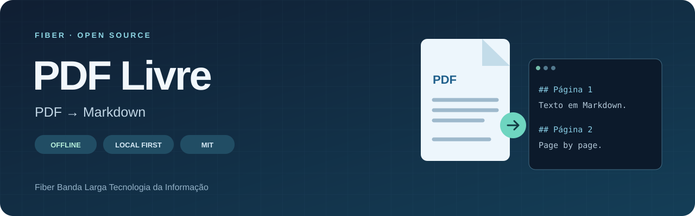
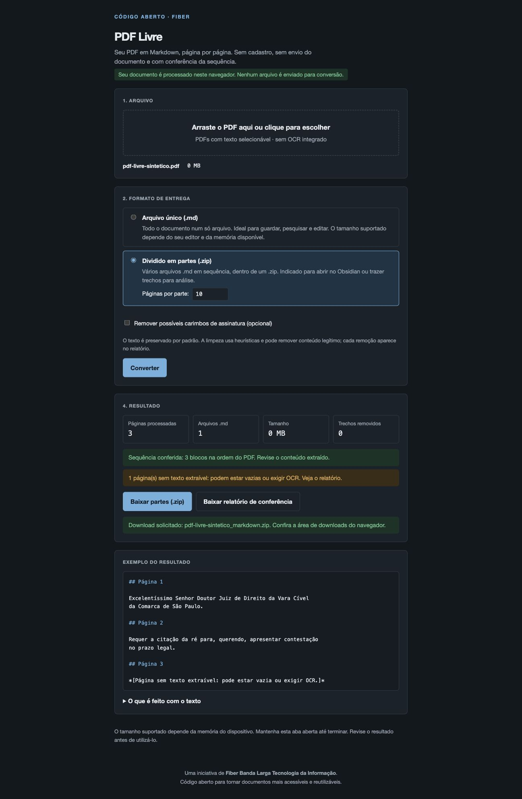

<div align="center">



# PDF Livre

### Seus documentos em Markdown. Seus arquivos sob seu controle.

Converta PDFs em texto organizado por página, direto no navegador.<br>
**Sem cadastro. Sem envio do documento para conversão. Código aberto.**

Uma iniciativa da **Fiber Banda Larga Tecnologia da Informação**.

[](https://github.com/Fiber-B-L-Tecnologia-da-Informacao/pdf-livre/actions/workflows/check.yml)
[](https://github.com/Fiber-B-L-Tecnologia-da-Informacao/pdf-livre/releases/latest)
[](./LICENSE)

**Português (Brasil)** · [English](./docs/i18n/README.en.md) · [Español](./docs/i18n/README.es.md)

*Documentação em três idiomas. A interface e os arquivos de saída continuam em português.*

[Baixar HTML offline](https://github.com/Fiber-B-L-Tecnologia-da-Informacao/pdf-livre/releases/latest/download/pdf-livre.html) · [Começar](#começar) · [Recursos](#recursos) · [Privacidade](#privacidade) · [Perguntas frequentes](#perguntas-frequentes) · [Contribuir](#contribuir)

</div>

---

> **Quer apenas usar?** [Baixe o HTML pronto](https://github.com/Fiber-B-L-Tecnologia-da-Informacao/pdf-livre/releases/latest/download/pdf-livre.html), salve e abra no navegador. Não precisa instalar Node.js, executar comandos ou enviar seu PDF a um site.

## Veja a ferramenta

<p align="center">
  
</p>

*Captura de um teste com documento sintético. Nenhum documento de usuário é exibido.*

## Por que PDF Livre?

Um PDF nem sempre é o melhor formato para pesquisar, editar ou reutilizar texto. O PDF Livre transforma o conteúdo extraível em Markdown e mantém uma referência para cada página do original.

Ele nasceu de uma ferramenta para documentos e processos extensos. A Fiber abriu o código para que outras pessoas possam usar, estudar e melhorar a solução — inclusive para outros tipos de documento.

### Para que você pode usar

| Objetivo | Como o PDF Livre ajuda |
| --- | --- |
| Pesquisar documentos extensos | Reúne o texto em Markdown com referência à página de origem |
| Editar e organizar texto | Gera arquivos abertos em editores de texto e ferramentas de notas |
| Separar documentos para leitura | Entrega partes numeradas em ZIP, com intervalos de páginas no nome |
| Conferir a extração | Produz relatório com páginas sem texto, erros e remoções opcionais |
| Estudar ou adaptar a ferramenta | Disponibiliza a mesma implementação usada para gerar o HTML de download |

## Recursos

- **Conversão local:** o navegador lê o PDF no seu dispositivo.
- **Referência por página:** cada bloco começa com `## Página N`.
- **Duas entregas:** um arquivo `.md` ou um ZIP com partes numeradas.
- **Conferência da sequência:** valida a quantidade e a ordem dos blocos gerados.
- **Relatório de extração:** lista páginas sem texto, páginas curtas, erros e trechos removidos.
- **Texto preservado por padrão:** limpeza de possíveis carimbos é opcional e registrada.
- **Cancelamento e progresso:** acompanhe as páginas processadas e interrompa a conversão.
- **Sem CDN:** bibliotecas e recursos são servidos junto com a aplicação.
- **Interface em português**, com adaptação ao tema claro ou escuro do dispositivo.

## Começar

### Usar sem instalar nada

1. [Baixe o arquivo **pdf-livre.html**](https://github.com/Fiber-B-L-Tecnologia-da-Informacao/pdf-livre/releases/latest/download/pdf-livre.html) na versão mais recente.
2. Salve no seu computador e abra o arquivo no navegador atualizado, por duplo clique ou **Abrir com**.
3. Escolha o PDF e converta. Depois do download do HTML, não é preciso internet, Node.js ou servidor local.

O HTML inclui interface, código, PDF.js, worker, JSZip e recursos auxiliares. Você pode guardá-lo em uma pasta ou pendrive e utilizá-lo sem acessar um site. As licenças estão incluídas no próprio arquivo. O download precisa terminar antes de abrir: a visualização de HTML do GitHub não é a ferramenta.

Para conferir a integridade, cada lançamento inclui `SHA256SUMS.txt`.

### Desenvolver ou melhorar o código

Instale o [Node.js](https://nodejs.org/) **24.22.2 ou superior**, em uma versão LTS suportada. Depois:

```bash
git clone https://github.com/Fiber-B-L-Tecnologia-da-Informacao/pdf-livre.git
cd pdf-livre
npm ci
npm run dev
```

Abra **http://127.0.0.1:4173** no navegador. A instalação baixa as dependências; a conversão não precisa de serviços externos. Esse servidor é para o código de desenvolvimento: o `index.html` do repositório usa módulos e arquivos separados. Para usar por duplo clique, baixe o `pdf-livre.html` da release.

### Converter

1. Escolha ou arraste um PDF com texto selecionável.
2. Selecione arquivo único ou partes em ZIP. No ZIP, escolha de 10 a 5.000 páginas por parte.
3. Mantenha a limpeza desativada para preservar o texto. Se a ativar, confira as remoções no relatório.
4. Clique em **Converter** e baixe o resultado e o relatório de conferência.

Exemplo de saída:

```markdown
# meu-documento

Páginas: 2

## Página 1

Texto extraído da primeira página.

## Página 2

Texto extraído da segunda página.
```

No modo ZIP, os nomes mantêm a ordem mesmo ao classificar por nome:

```text
meu-documento_parte_001_pag_00001_a_00300.md
meu-documento_parte_002_pag_00301_a_00600.md
_relatorio_de_conferencia.txt
```

## Como funciona

```text
PDF no seu computador
        ↓
Leitura local com PDF.js
        ↓
Extração e organização por página
        ↓
Conferência da sequência e relatório
        ↓
Markdown único ou partes em ZIP
```

O processamento ocorre na memória do navegador. O arquivo original não é alterado. A divisão em partes se aplica à saída; o aplicativo ainda precisa de memória para ler o PDF e produzir o resultado.

## Teste com um documento grande

O mantenedor relata uma conversão bem-sucedida de um **PDF gerado com 50.000 páginas e mais de 600 MB**, com extração para Markdown. Esse é um teste de uso relatado, não um limite garantido nem um benchmark reproduzido nesta versão. O tempo e o tamanho suportado dependem do documento, do navegador e da memória disponível.

## Privacidade

O aplicativo não contém upload de documentos, analytics ou serviços de conversão remota. O PDF é lido em memória, e os downloads são criados no navegador. Não há persistência de documentos pela aplicação.

Na distribuição em HTML único, a política de conteúdo bloqueia conexões da aplicação (`connect-src none`). Não há GitHub Pages ou serviço de conversão exigido: o GitHub distribui o arquivo para download. Extensões do navegador, o próprio dispositivo e modificações de terceiros estão fora do controle deste projeto.

O relatório pode conter trechos do documento, incluindo texto removido. Trate o Markdown, o ZIP e o relatório com a mesma confidencialidade do PDF original.

## Limitações que vale conhecer

- **Não faz OCR.** PDFs digitalizados podem não produzir texto. Uma página sem texto também pode estar vazia.
- **Não reconstrói a diagramação.** Tabelas, colunas, imagens, fórmulas e ordem visual complexa podem perder estrutura.
- **Conferir páginas não comprova fidelidade.** A validação verifica os blocos gerados, não a equivalência integral ao original. Erros de leitura ficam marcados.
- **A limpeza é heurística.** Pode remover conteúdo legítimo, sobretudo texto girado. Por isso vem desligada.
- **Não há tamanho máximo garantido.** Arquivos grandes e compactação consomem memória. Dividir o resultado facilita o uso, mas não elimina o consumo em memória da conversão.
- **PDFs protegidos por senha** exigem uma cópia desbloqueada.
- **A inspeção textual de segurança é limitada.** Sinaliza alguns caracteres invisíveis e possíveis instruções com página e trecho; não é uma auditoria de fontes, camadas, malware ou de toda divergência visual.

O texto do PDF deve ser tratado como conteúdo não confiável, especialmente quando enviado a ferramentas de IA. O aplicativo não executa instruções do documento.

## Desenvolvimento

JavaScript com módulos nativos, CSS e HTML, sem framework. O código-fonte continua separado e completo; esbuild empacota esse mesmo código no HTML único, sem uma segunda implementação mantida à mão.

| Comando | Finalidade |
| --- | --- |
| `npm ci` | Instala versões fixadas e prepara as bibliotecas locais |
| `npm run dev` | Inicia o servidor local na porta 4173 |
| `npm test` | Executa testes de extração e conversão |
| `npm run build` | Gera a pasta estática e o HTML único em `dist/` |
| `npm run build:offline` | Gera `dist/pdf-livre.html` e seu SHA-256 |
| `npm run preview:offline` | Abre um servidor de teste para o HTML único |
| `npm run check` | Verifica sintaxe, testes e geração da distribuição |
| `node scripts/serve.mjs --dist` | Testa a distribuição gerada |

```text
src/          Interface, estilos e lógica de conversão
scripts/      Preparação de bibliotecas, servidor e distribuição
tests/        Casos sintéticos; sem documentos pessoais
assets/       Recursos visuais do projeto
docs/         Arquitetura e registro da recuperação do código
.github/      Verificação automatizada
```

### Gerar a versão para distribuição

```bash
npm ci
npm run check
```

O arquivo `dist/pdf-livre.html` é o download pronto para uso. `dist/SHA256SUMS.txt` contém seu SHA-256. A pasta `dist/` também inclui a distribuição com arquivos separados para testes de desenvolvimento; não é necessário hospedar o aplicativo para utilizar o HTML único.

O empacotamento inclui as dependências, os recursos auxiliares e os avisos de licença. A instalação e a geração exigem internet para obter dependências; o uso do HTML gerado não. Navegadores modernos são necessários para os recursos utilizados pelo PDF.js.

O workflow de lançamento gera e verifica o arquivo no GitHub Actions quando a versão de `package.json` muda na branch `main`, e o publica como anexo em **Releases**. Consulte [a arquitetura](./docs/ARCHITECTURE.md) e [o registro de validação](./docs/OFFLINE.md).

## Perguntas frequentes

<details>
<summary><strong>Preciso instalar alguma coisa para converter?</strong></summary>

Não. Baixe o `pdf-livre.html` da release, espere o download terminar e abra no navegador atualizado. Node.js e os comandos de instalação são apenas para desenvolvimento.

</details>

<details>
<summary><strong>Funciona sem internet e sem GitHub aberto?</strong></summary>

Sim. Depois de baixar o HTML, a conversão não depende de acessar o GitHub ou um site. O mantenedor confirmou a abertura direta e a conversão sem internet; o teste de navegador com rede desativada está registrado em [docs/OFFLINE.md](./docs/OFFLINE.md).

</details>

<details>
<summary><strong>Serve para PDFs escaneados?</strong></summary>

Somente se já tiverem uma camada de texto, por exemplo, criada anteriormente por OCR. O PDF Livre não faz reconhecimento de imagens. Páginas sem texto são sinalizadas, mas também podem ser páginas vazias.

</details>

<details>
<summary><strong>Por que a saída não fica igual à página do PDF?</strong></summary>

A saída é texto organizado por página, não uma reprodução visual. Tabelas, colunas e elementos gráficos podem perder estrutura. A sequência conferida não comprova que todo o texto foi extraído fielmente.

</details>

<details>
<summary><strong>A tradução da documentação muda o idioma da aplicação?</strong></summary>

Não. As versões em inglês e espanhol explicam a mesma ferramenta; a interface, os marcadores `## Página N` e o relatório continuam em português.

</details>

<details>
<summary><strong>Posso modificar e usar na minha empresa?</strong></summary>

Sim, inclusive comercialmente, conforme a licença MIT do código próprio. Preserve os avisos de licença e respeite as licenças das bibliotecas de terceiros.

</details>

## Documentação do projeto

| Documento | Conteúdo |
| --- | --- |
| [Arquitetura](./docs/ARCHITECTURE.md) | Módulos, fluxo, cancelamento e empacotamento offline |
| [Validação offline](./docs/OFFLINE.md) | Testes realizados, confirmação manual e verificação de integridade |
| [Recuperação do código](./docs/RECOVERY.md) | Origem do projeto, análise com REA e alterações para publicação |
| [Contribuição](./CONTRIBUTING.md) | Preparação do ambiente, testes e envio de melhorias |
| [Segurança](./SECURITY.md) | Cuidados com relatos de vulnerabilidades e documentos privados |
| [Bibliotecas de terceiros](./THIRD_PARTY_NOTICES.md) | Dependências, créditos e licenças |

## Contribuir

Encontrou um problema? Abra uma [issue](https://github.com/Fiber-B-L-Tecnologia-da-Informacao/pdf-livre/issues) com o comportamento esperado e o observado. Use exemplos sintéticos e nunca publique documentos pessoais, jurídicos ou empresariais confidenciais.

Para enviar uma melhoria, consulte [CONTRIBUTING.md](./CONTRIBUTING.md). Mudanças na extração devem incluir um teste que demonstre o problema e a correção.

Melhorias em extração, acessibilidade, documentação, traduções e testes são bem-vindas. Ao relatar um erro, informe a versão do PDF Livre, navegador, sistema operacional e passos para reproduzir. Se precisar de um arquivo de exemplo, crie um PDF sintético que reproduza o problema.

## Sobre a Fiber

A **Fiber Banda Larga Tecnologia da Informação** disponibiliza este projeto para compartilhar conhecimento e colaborar com a comunidade de software livre. Se ele for útil, considere dar uma estrela, compartilhar o repositório e contribuir com melhorias.

## Licença

Código próprio sob a [licença MIT](./LICENSE): você pode usar, modificar e redistribuir, inclusive comercialmente, mantendo o aviso de licença. Bibliotecas de terceiros mantêm suas próprias licenças; consulte [THIRD_PARTY_NOTICES.md](./THIRD_PARTY_NOTICES.md).
