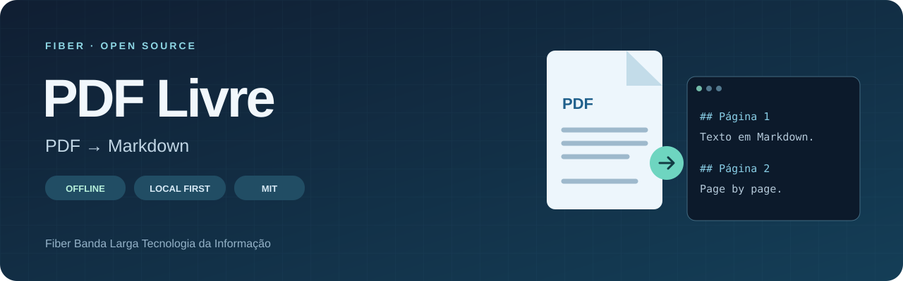
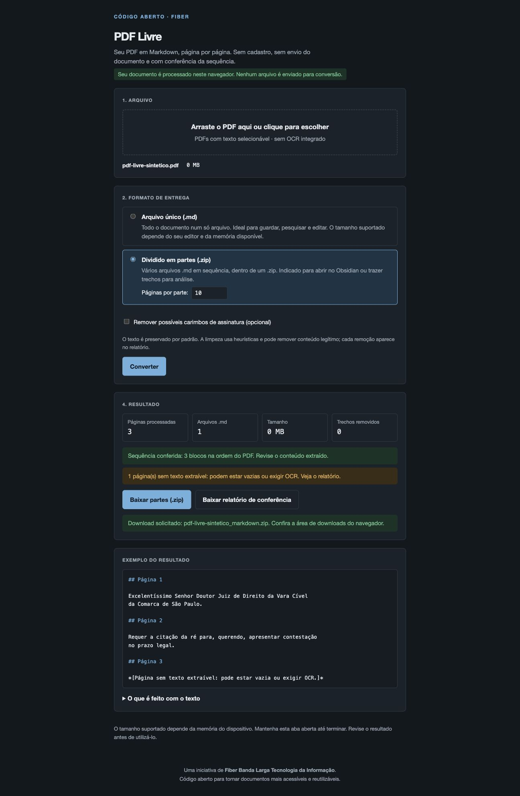

<div align="center">



# PDF Livre

### Your documents in Markdown. Your files under your control.

Turn PDF text into page-by-page Markdown, directly in your browser.<br>
**No account. No document upload for conversion. Open source.**

An initiative by **Fiber Banda Larga Tecnologia da Informação**.

[](https://github.com/Fiber-B-L-Tecnologia-da-Informacao/pdf-livre/actions/workflows/check.yml)
[](https://github.com/Fiber-B-L-Tecnologia-da-Informacao/pdf-livre/releases/latest)
[](../../LICENSE)

[Português (Brasil)](../../README.md) · **English** · [Español](./README.es.md)

*Documentation is available in three languages. The application interface and generated output remain in Portuguese.*

[Download offline HTML](https://github.com/Fiber-B-L-Tecnologia-da-Informacao/pdf-livre/releases/latest/download/pdf-livre.html) · [Get started](#get-started) · [Features](#features) · [Privacy](#privacy) · [FAQ](#faq) · [Contribute](#contribute)

</div>

---

> **Just want to use it?** Download the ready-to-use HTML, save it, and open it in an up-to-date browser. No Node.js, commands, or PDF upload to a website required.

## See the application

<p align="center"></p>

*Screenshot from a synthetic document test. No user document is shown.*

## Why PDF Livre?

PDF is not always convenient for searching, editing, or reusing text. PDF Livre extracts the available text into Markdown while retaining a reference to each original page.

The project grew out of a tool for lengthy documents and legal case files. Fiber released the source so others can use, study, and improve it for other document types too.

| Goal | How it helps |
| --- | --- |
| Search long documents | Collects extracted text with source-page references |
| Edit and organize text | Creates files for text editors and note-taking tools |
| Split documents for reading | Produces numbered ZIP parts with page ranges in filenames |
| Review extraction | Reports missing text, page errors, and optional removals |
| Study or adapt the tool | Provides the same implementation used to build the downloadable HTML |

## Features

- Local browser processing, with no document upload for conversion.
- One `## Página N` block for every PDF page, in original page order.
- A single Markdown file or a ZIP with numbered Markdown parts.
- Validation of generated block count and order.
- A report listing pages with no extractable text, little text, reading errors, and removed passages.
- Text preserved by default; optional signature-stamp cleanup with a removal log.
- Progress and cancellation controls.
- Bundled PDF.js, worker, JSZip, fonts, CMaps, and auxiliary resources; no CDN required.
- Portuguese interface with light/dark styling based on device preferences.

## Get started

### Use without installing anything

1. [Download **pdf-livre.html**](https://github.com/Fiber-B-L-Tecnologia-da-Informacao/pdf-livre/releases/latest/download/pdf-livre.html).
2. Save it, wait for the download to finish, and open the file in an up-to-date browser.
3. Choose your PDF and convert. No internet, Node.js, or local server is required after downloading the HTML.

The file can be kept in a folder or on a USB drive. Licenses are included inside it. GitHub's HTML source preview is not the running application. Each release includes `SHA256SUMS.txt` for integrity verification.

### Convert a document

1. Select or drop a PDF with selectable text.
2. Choose a single file or ZIP parts, with 10–5,000 pages per part.
3. Leave cleanup disabled to preserve text. If enabled, review all removals in the report.
4. Click **Converter**, then download the output and verification report.

Example output — page markers remain in Portuguese:

```markdown
# document

Páginas: 2

## Página 1

Text extracted from the first page.

## Página 2

Text extracted from the second page.
```

ZIP filenames preserve sorting order:

```text
document_parte_001_pag_00001_a_00300.md
document_parte_002_pag_00301_a_00600.md
_relatorio_de_conferencia.txt
```

## How it works

```text
Local PDF → PDF.js reader → Page-by-page extraction
          → Sequence check and report → Markdown or ZIP
```

Processing uses browser memory and does not change the original file. Splitting the output does not remove the memory needed to read the PDF and generate the results.

## Large-document test

The maintainer reports successfully converting a **generated PDF with 50,000 pages and more than 600 MB** to Markdown. This is a reported usage test, not a guaranteed limit or a benchmark reproduced for this release. Results depend on document content, browser, and available memory.

## Privacy

The application has no document upload, analytics, or remote conversion service. It reads the PDF in memory and creates downloads locally. The application does not persist documents.

The standalone HTML's content security policy blocks application connections with `connect-src 'none'`. GitHub distributes the download; GitHub Pages is not required. Browser extensions, the device itself, and third-party modifications remain outside the project's control.

The report can contain original document passages, including removed text. Treat Markdown, ZIP, and report files with the same confidentiality as the source PDF.

## Limitations

- **No OCR.** Scanned documents need an existing text layer. A page with no extractable text may also be blank.
- **No faithful layout reconstruction.** Tables, columns, graphics, formulas, and complex reading order may lose structure.
- **Sequence validation is not fidelity validation.** It checks generated page blocks; reading errors receive explicit markers.
- **Cleanup is heuristic.** It can remove legitimate text, especially rotated content, and is disabled by default.
- **No guaranteed maximum file size.** Large PDFs and ZIP generation consume memory, even when output is split.
- **Password-protected PDFs** require an unlocked copy.
- **Text security checks are limited.** They flag some invisible characters and possible instructions with page and excerpt. They are not a complete font, layer, malware, or visual-difference audit.

Treat PDF text as untrusted content, particularly when supplying it to AI tools. The application does not execute instructions contained in documents.

## Development

Use **Node.js 24.22.2 or later in a supported LTS release**:

```bash
git clone https://github.com/Fiber-B-L-Tecnologia-da-Informacao/pdf-livre.git
cd pdf-livre
npm ci
npm run dev
```

Open **http://127.0.0.1:4173**. This server runs the separate development files; use the released `pdf-livre.html` for direct file opening.

The project uses native JavaScript modules, HTML, and CSS, without a framework. esbuild packages this same source into one HTML file; there is no separately maintained conversion implementation.

| Command | Purpose |
| --- | --- |
| `npm ci` | Install locked dependencies and prepare local libraries |
| `npm run dev` | Start the development server on port 4173 |
| `npm test` | Run extraction, conversion, and packaging tests |
| `npm run build` | Generate the static folder and standalone HTML |
| `npm run build:offline` | Generate `dist/pdf-livre.html` and its SHA-256 |
| `npm run preview:offline` | Preview the standalone HTML over local HTTP |
| `npm run check` | Check syntax, run tests, and build distributions |
| `node scripts/serve.mjs --dist` | Preview the static distribution |

```text
src/       UI, styles, conversion and embedded-resource adapters
scripts/   Library preparation, development server and builds
tests/     Synthetic cases without personal documents
assets/    Visual assets
docs/      Architecture, validation and translations
.github/   Checks and release automation
```

Installation and generation may download dependencies; using the generated HTML does not require the internet. Modern browser features supported by PDF.js are required. Changing the version in `package.json` on `main` triggers the release workflow, which checks and publishes the HTML and checksum as release assets, without enabling Pages.

## FAQ

<details><summary><strong>Does it work with GitHub closed and the internet disconnected?</strong></summary>

Yes. The maintainer confirmed direct file opening and offline conversion. Browser testing also exercised conversion and downloads with the tab's network disabled. See the [validation record](../OFFLINE.md), in Portuguese.

</details>

<details><summary><strong>Does the English README translate the application?</strong></summary>

No. The interface, `## Página N` markers and report remain in Portuguese. This document explains the same application in English.

</details>

<details><summary><strong>Can I use or modify it for my business?</strong></summary>

Yes, including commercially, under the MIT license for original code. Keep license notices and comply with third-party dependency licenses.

</details>

## Project documentation

Technical documents are currently in Portuguese:

- [Architecture](../ARCHITECTURE.md): modules, cancellation and offline packaging.
- [Offline validation](../OFFLINE.md): tests, manual confirmation and checksums.
- [Code recovery](../RECOVERY.md): origin, REA analysis and publication changes.
- [Contributing](../../CONTRIBUTING.md), [security](../../SECURITY.md) and [third-party notices](../../THIRD_PARTY_NOTICES.md).

## Contribute

Open an [issue](https://github.com/Fiber-B-L-Tecnologia-da-Informacao/pdf-livre/issues) with expected and observed behavior, application version, browser, operating system and reproduction steps. Use synthetic examples; never publish personal, legal, or confidential business documents.

Improvements to extraction, accessibility, documentation, translations, and tests are welcome. Extraction changes should include a regression test. Follow [CONTRIBUTING.md](../../CONTRIBUTING.md).

## About Fiber

**Fiber Banda Larga Tecnologia da Informação** shares this project to contribute knowledge and collaborate with the open-source community. If it helps you, consider starring the repository, sharing it, or contributing improvements.

## License

Original code is available under the [MIT license](../../LICENSE), including commercial use, modification and redistribution with the license notice retained. Dependencies keep their own licenses; see [THIRD_PARTY_NOTICES.md](../../THIRD_PARTY_NOTICES.md).
