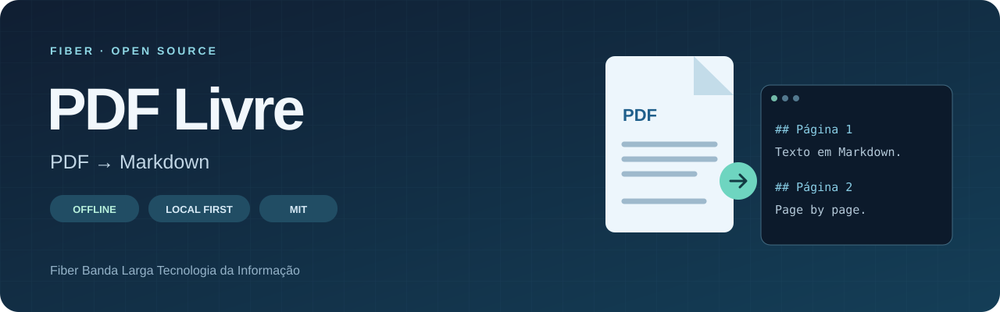
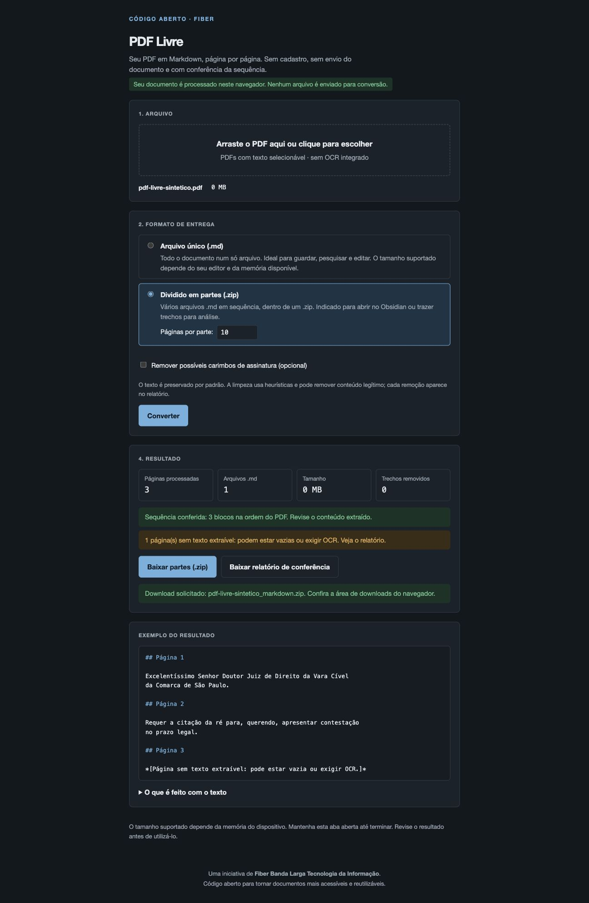

<div align="center">



# PDF Livre

### Tus documentos en Markdown. Tus archivos bajo tu control.

Convierte el texto de un PDF en Markdown, página por página, en tu navegador.<br>
**Sin registro. Sin subir documentos para convertirlos. Código abierto.**

Una iniciativa de **Fiber Banda Larga Tecnologia da Informação**.

[](https://github.com/Fiber-B-L-Tecnologia-da-Informacao/pdf-livre/actions/workflows/check.yml)
[](https://github.com/Fiber-B-L-Tecnologia-da-Informacao/pdf-livre/releases/latest)
[](../../LICENSE)

[Português (Brasil)](../../README.md) · [English](./README.en.md) · **Español**

*Documentación en tres idiomas. La interfaz y los archivos generados siguen en portugués.*

[Descargar HTML sin conexión](https://github.com/Fiber-B-L-Tecnologia-da-Informacao/pdf-livre/releases/latest/download/pdf-livre.html) · [Primeros pasos](#primeros-pasos) · [Funciones](#funciones) · [Privacidad](#privacidad) · [Preguntas frecuentes](#preguntas-frecuentes) · [Contribuir](#contribuir)

</div>

---

> **¿Solo quieres usarlo?** Descarga el HTML listo para usar, guárdalo y ábrelo en un navegador actualizado. No necesitas Node.js, comandos ni subir el PDF a un sitio web.

## Mira la herramienta

<p align="center"></p>

*Captura de una prueba con un documento sintético. No se muestra ningún documento de usuario.*

## ¿Por qué PDF Livre?

El PDF no siempre facilita buscar, editar o reutilizar texto. PDF Livre extrae el contenido disponible en Markdown y conserva una referencia a cada página del original.

El proyecto nació de una herramienta para documentos extensos y expedientes judiciales. Fiber abrió el código para que otras personas puedan utilizarlo, estudiarlo y mejorarlo, también para otros tipos de documentos.

| Objetivo | Cómo ayuda |
| --- | --- |
| Buscar en documentos extensos | Reúne el texto con referencias a las páginas de origen |
| Editar y organizar texto | Genera archivos para editores de texto y herramientas de notas |
| Dividir documentos para leerlos | Entrega partes numeradas en ZIP con intervalos de páginas en los nombres |
| Revisar la extracción | Informa de páginas sin texto, errores y eliminaciones opcionales |
| Estudiar o adaptar la herramienta | Publica la misma implementación que genera el HTML descargable |

## Funciones

- Procesamiento local en el navegador, sin subir documentos para convertirlos.
- Un bloque `## Página N` por página del PDF, en el orden original.
- Un archivo Markdown único o un ZIP con partes numeradas.
- Validación de cantidad y orden de los bloques generados.
- Informe con páginas sin texto extraíble, con poco texto, con errores y fragmentos eliminados.
- Texto conservado por defecto; limpieza opcional de posibles sellos de firma, con registro de eliminaciones.
- Indicadores de progreso y cancelación.
- PDF.js, worker, JSZip, fuentes, CMaps y recursos auxiliares incluidos; sin depender de una CDN.
- Interfaz en portugués con estilos claros u oscuros según las preferencias del dispositivo.

## Primeros pasos

### Usar sin instalar nada

1. [Descarga **pdf-livre.html**](https://github.com/Fiber-B-L-Tecnologia-da-Informacao/pdf-livre/releases/latest/download/pdf-livre.html).
2. Guárdalo, espera a que termine la descarga y ábrelo en un navegador actualizado.
3. Selecciona tu PDF y conviértelo. Después de descargar el HTML no necesitas internet, Node.js ni un servidor local.

Puedes guardarlo en una carpeta o memoria USB. Las licencias están incluidas en el archivo. La vista del código HTML en GitHub no es la aplicación en ejecución. Cada lanzamiento incluye `SHA256SUMS.txt` para verificar la integridad.

### Convertir un documento

1. Selecciona o arrastra un PDF con texto seleccionable.
2. Elige archivo único o partes en ZIP, entre 10 y 5.000 páginas por parte.
3. Deja la limpieza desactivada para conservar el texto. Si la activas, revisa las eliminaciones en el informe.
4. Pulsa **Converter** y descarga el resultado y el informe de verificación.

Ejemplo de salida — los marcadores siguen en portugués:

```markdown
# documento

Páginas: 2

## Página 1

Texto extraído de la primera página.

## Página 2

Texto extraído de la segunda página.
```

Los nombres del ZIP mantienen el orden al clasificarlos:

```text
documento_parte_001_pag_00001_a_00300.md
documento_parte_002_pag_00301_a_00600.md
_relatorio_de_conferencia.txt
```

## Cómo funciona

```text
PDF local → Lector PDF.js → Extracción por página
          → Verificación de secuencia e informe → Markdown o ZIP
```

El procesamiento utiliza la memoria del navegador y no modifica el archivo original. Dividir la salida no elimina la memoria necesaria para leer el PDF y generar los resultados.

## Prueba con un documento grande

El mantenedor informa de una conversión exitosa a Markdown de un **PDF generado con 50.000 páginas y más de 600 MB**. Es una prueba de uso relatada, no un límite garantizado ni un benchmark reproducido para esta versión. El resultado depende del contenido del documento, del navegador y de la memoria disponible.

## Privacidad

La aplicación no incluye subida de documentos, analytics ni servicios remotos de conversión. Lee el PDF en memoria y crea las descargas localmente. La aplicación no almacena los documentos de forma persistente.

La política de seguridad del HTML único bloquea las conexiones de la aplicación con `connect-src 'none'`. GitHub distribuye el archivo; no se necesita GitHub Pages. Las extensiones del navegador, el propio dispositivo y las modificaciones de terceros quedan fuera del control del proyecto.

El informe puede contener fragmentos del documento original, incluido el texto eliminado. Trata los archivos Markdown, ZIP e informes con la misma confidencialidad que el PDF.

## Limitaciones

- **Sin OCR.** Los documentos escaneados necesitan una capa de texto previa. Una página sin texto extraíble también puede estar vacía.
- **Sin reconstrucción fiel del diseño.** Tablas, columnas, gráficos, fórmulas y orden visual complejo pueden perder estructura.
- **La secuencia no garantiza fidelidad.** La comprobación valida los bloques generados; los errores de lectura quedan señalados.
- **La limpieza es heurística.** Puede eliminar contenido legítimo, sobre todo texto girado; viene desactivada.
- **Sin tamaño máximo garantizado.** Los PDF grandes y la generación del ZIP consumen memoria, incluso con salida dividida.
- **Los PDF protegidos con contraseña** requieren una copia desbloqueada.
- **La inspección textual de seguridad es limitada.** Señala algunos caracteres invisibles y posibles instrucciones con página y fragmento; no es una auditoría completa de fuentes, capas, malware o diferencias visuales.

Trata el texto de los PDF como contenido no confiable, especialmente al proporcionarlo a herramientas de IA. La aplicación no ejecuta instrucciones contenidas en los documentos.

## Desarrollo

Utiliza **Node.js 24.22.2 o posterior en una versión LTS compatible**:

```bash
git clone https://github.com/Fiber-B-L-Tecnologia-da-Informacao/pdf-livre.git
cd pdf-livre
npm ci
npm run dev
```

Abre **http://127.0.0.1:4173**. Este servidor utiliza los archivos separados de desarrollo; para abrir directamente un archivo, utiliza el `pdf-livre.html` de la release.

El proyecto utiliza módulos nativos de JavaScript, HTML y CSS, sin framework. esbuild empaqueta ese mismo código en un HTML único; no se mantiene una segunda implementación de la conversión.

| Comando | Finalidad |
| --- | --- |
| `npm ci` | Instalar dependencias fijadas y preparar bibliotecas locales |
| `npm run dev` | Iniciar el servidor de desarrollo en el puerto 4173 |
| `npm test` | Ejecutar pruebas de extracción, conversión y empaquetado |
| `npm run build` | Generar la carpeta estática y el HTML único |
| `npm run build:offline` | Generar `dist/pdf-livre.html` y su SHA-256 |
| `npm run preview:offline` | Probar el HTML único mediante HTTP local |
| `npm run check` | Verificar sintaxis, ejecutar pruebas y generar distribuciones |
| `node scripts/serve.mjs --dist` | Probar la distribución estática |

```text
src/       Interfaz, estilos, conversión y recursos embutidos
scripts/   Preparación de bibliotecas, servidor y generación
tests/     Casos sintéticos sin documentos personales
assets/    Recursos visuales
docs/      Arquitectura, validación y traducciones
.github/   Verificaciones y automatización de lanzamientos
```

La instalación y la generación pueden descargar dependencias; usar el HTML generado no requiere internet. Son necesarias las funciones de navegador moderno utilizadas por PDF.js. Cambiar la versión en `package.json` en `main` activa el workflow que verifica y publica el HTML y el checksum como anexos de la release, sin habilitar Pages.

## Preguntas frecuentes

<details><summary><strong>¿Funciona con GitHub cerrado y sin internet?</strong></summary>

Sí. El mantenedor confirmó la apertura directa y la conversión sin conexión. También se probaron conversión y descargas con la red de la pestaña desactivada. Consulta el [registro de validación](../OFFLINE.md), en portugués.

</details>

<details><summary><strong>¿Este README cambia el idioma de la aplicación?</strong></summary>

No. La interfaz, los marcadores `## Página N` y el informe siguen en portugués. Este documento explica la misma aplicación en español.

</details>

<details><summary><strong>¿Puedo modificarlo y utilizarlo en mi empresa?</strong></summary>

Sí, incluso comercialmente, conforme a la licencia MIT del código propio. Conserva los avisos de licencia y respeta las licencias de las dependencias.

</details>

## Documentación del proyecto

Los documentos técnicos están actualmente en portugués:

- [Arquitectura](../ARCHITECTURE.md): módulos, cancelación y empaquetado sin conexión.
- [Validación offline](../OFFLINE.md): pruebas, confirmación manual y checksums.
- [Recuperación del código](../RECOVERY.md): origen, análisis con REA y cambios para publicación.
- [Contribución](../../CONTRIBUTING.md), [seguridad](../../SECURITY.md) y [avisos de terceros](../../THIRD_PARTY_NOTICES.md).

## Contribuir

Abre una [issue](https://github.com/Fiber-B-L-Tecnologia-da-Informacao/pdf-livre/issues) con el comportamiento esperado y observado, versión de la aplicación, navegador, sistema operativo y pasos para reproducir el problema. Usa ejemplos sintéticos; nunca publiques documentos personales, jurídicos o empresariales confidenciales.

Son bienvenidas las mejoras de extracción, accesibilidad, documentación, traducciones y pruebas. Los cambios en la extracción deben incluir una prueba de regresión. Consulta [CONTRIBUTING.md](../../CONTRIBUTING.md).

## Sobre Fiber

**Fiber Banda Larga Tecnologia da Informação** comparte este proyecto para aportar conocimiento y colaborar con la comunidad de código abierto. Si te resulta útil, considera dar una estrella al repositorio, compartirlo o contribuir con mejoras.

## Licencia

El código propio está disponible bajo la [licencia MIT](../../LICENSE), que permite uso comercial, modificación y redistribución conservando el aviso de licencia. Las dependencias mantienen sus propias licencias; consulta [THIRD_PARTY_NOTICES.md](../../THIRD_PARTY_NOTICES.md).
